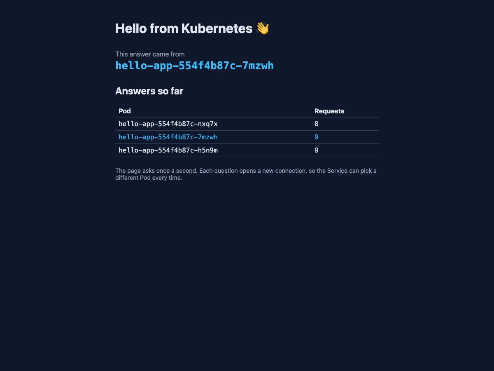

# Lab 2 — hello-app on Kubernetes

Your copy of this repository is your submission. The lab sheet is on the course site; this file is where you record what you did.

What's here:

| File | What it is |
|---|---|
| `src/`, `index.html` | a small React page that shows which Pod answered |
| `nginx.conf` | serves the page, and answers `/whoami` with the Pod name |
| `Dockerfile` | builds the page, then serves it with nginx on port 80 |

You don't change any of these. You add `hello-app.yaml` and fill in the sections below.

## Before you push, check

- [x] `hello-app.yaml` is in the root of this repository
- [x] `screenshot.png` is in the root of this repository
- [x] every section below is filled in

---

## 1. My image

Docker Hub image I deployed (for example `ravi123/hello-app:v1`):

```
sudoprasad/hello-app:v1
```

## 2. Pods across nodes

Output of `kubectl get pods -o wide` after you applied `hello-app.yaml`:

```
NAME                        READY   STATUS    RESTARTS   AGE     IP           NODE              NOMINATED NODE   READINESS GATES
hello-app-554f4b87c-7mzwh   1/1     Running   0          2m59s   10.244.1.4   desktop-worker2   <none>           <none>
hello-app-554f4b87c-h5n9m   1/1     Running   0          2m59s   10.244.2.7   desktop-worker    <none>           <none>
hello-app-554f4b87c-nxq7x   1/1     Running   0          2m59s   10.244.2.6   desktop-worker    <none>           <none>
```

## 3. The Service and its endpoints

Output of `kubectl get service hello-app` and `kubectl get endpointslices -l kubernetes.io/service-name=hello-app`:

```
NAME        TYPE           CLUSTER-IP    EXTERNAL-IP    PORT(S)          AGE
hello-app   LoadBalancer   10.96.101.1   192.168.97.5   8080:31490/TCP   2m59s

NAME              ADDRESSTYPE   PORTS   ENDPOINTS                          AGE
hello-app-77pg8   IPv4          80      10.244.1.4,10.244.2.6,10.244.2.7   2m59s
```

## 4. Browser

Add `screenshot.png`: the page at `http://localhost:8080` with at least two Pods in the "Answers so far" table.

`screenshot.png` is saved in the repository root.



## 5. The four traps

For each trap, write what you saw and why it happened, in two or three lines of your own words.

**Trap 1 — the local image.**
- **What I saw:** The Pods stayed stuck in `ErrImagePull` and `ImagePullBackOff`. Running `kubectl describe pod` showed: `failed to pull and unpack image "docker.io/library/hello-app:v1": pull access denied, repository does not exist or may require authorization`.
- **Why it happened:** The cluster's worker nodes are separate machines with their own isolated image caches and cannot access images stored only on the host machine's Docker daemon. Without a registry or username prefix, Kubernetes assumed `hello-app:v1` was an official image on Docker Hub (`docker.io/library/hello-app:v1`), which did not exist until tagged with my Docker Hub username (`sudoprasad/hello-app:v1`) and pushed to Docker Hub.

**Trap 2 — the selector typo.**
- **What I saw:** The Service and Pods remained active, but `kubectl get endpointslices` showed `<unset>` for ports and endpoints (empty). In the browser, requests failed with a connection error unable to reach `/whoami`.
- **Why it happened:** The Service routes traffic using `spec.selector` (`app: helo-app`). Because none of the Pods had the misspelled label `app: helo-app` (the Pods were labeled `app: hello-app`), the Service matched zero Pods, left the EndpointSlice empty, and had nowhere to route incoming client traffic.

**Trap 3 — the wrong targetPort.**
- **What I saw:** The EndpointSlice listed the healthy Pod IPs, but registered their port as `8080` instead of `80`. The browser showed an error trying to fetch `/whoami`.
- **Why it happened:** `targetPort` specifies the port inside each selected container where the application listens. The Service directed traffic to container port 8080, but nginx inside each Pod was listening on port 80. Since no application process was listening on port 8080, incoming connections were refused.

**Trap 4 — the EXTERNAL-IP address.**
- **What I saw:** `kubectl get service` listed an internal network address under `EXTERNAL-IP` (such as `192.168.97.5` or `172.21.0.8`). Attempting to browse to this address directly does not load on standard setups.
- **Why it happened:** In a local Kubernetes development environment, the EXTERNAL-IP is allocated on the internal Docker bridge/cluster network rather than being a publicly routable IP. The local development environment instead binds the LoadBalancer port directly to `localhost`, meaning host traffic must access the application via `http://localhost:8080`.

## 6. Your YAML vs the generated YAML

Name two fields in the `--dry-run=client -o yaml` output that were not in your file. Why does your file still work without them?

1. `strategy: {}` (in the Deployment spec):
   - **Why it works without it:** When omitted from the manifest, Kubernetes automatically applies the default deployment update strategy, which is `RollingUpdate` with default parameters `maxSurge: 25%` and `maxUnavailable: 25%`. It only needs to be explicitly specified if you need custom rollout behavior (such as `Recreate` or specific surge counts).
2. `resources: {}` (in container spec) or `status: {}` (at root level):
   - **Why it works without it:** In Kubernetes, container `resources` (CPU and memory `requests` and `limits`) are optional. If omitted, the Pod runs in the `BestEffort` Quality of Service (QoS) tier without resource constraints, using whatever resources the host node has available. Similarly, `status` is a read-only field tracked and updated dynamically at runtime by Kubernetes controllers; it is not part of the user's declared desired state.
